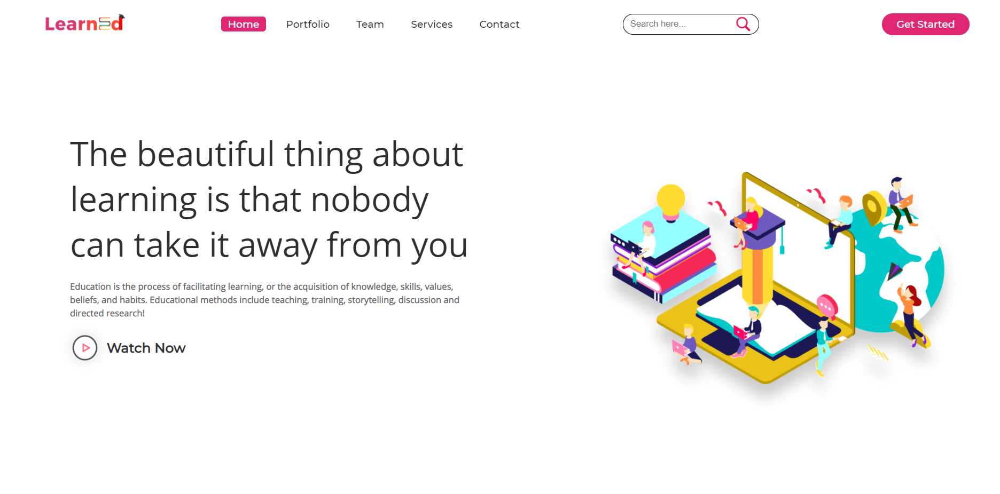

# E-Learning Website

A web-based e-learning project that presents computer-learning content through a browser interface.

## Preview



## Features

- Browse the learning website interface.
- Access the login page.
- Responsive styling for the available pages.

## Tech Stack

- HTML
- CSS
- JavaScript (where implemented in the project)

## Run Locally

1. Clone this repository:
   ```bash
   git clone https://github.com/PreciousBharath/my-project-e-learn.git
   ```
2. Open the project folder.
3. Open `index.html` in your browser. If you use VS Code, you can also run it with the Live Server extension.

## Project Structure

- `index.html` — main page
- `login.html` — login page
- `loginStyle.css` — login-page styles
- `pcView.png` — project preview image

## Screenshots

The preview above uses the image already present in this repository. Add further screenshots of important pages (for example, the home page and login page) to this folder and link them here.

## Author

**Bharath** — [GitHub Profile](https://github.com/PreciousBharath)

---
If you find this project useful, feel free to star the repository.
